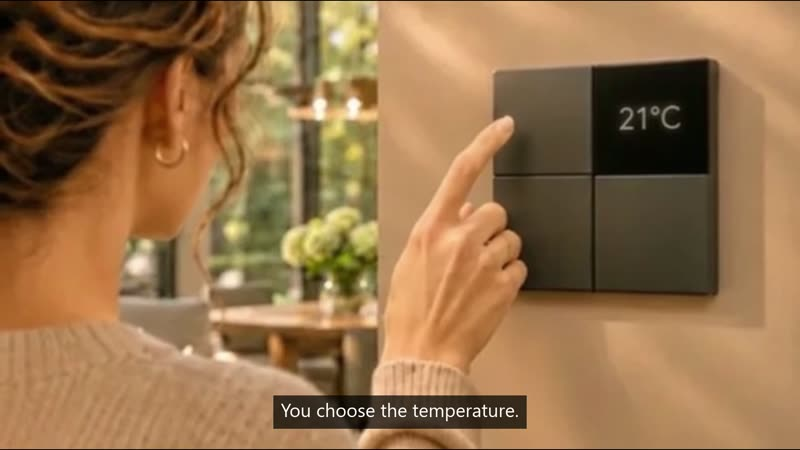
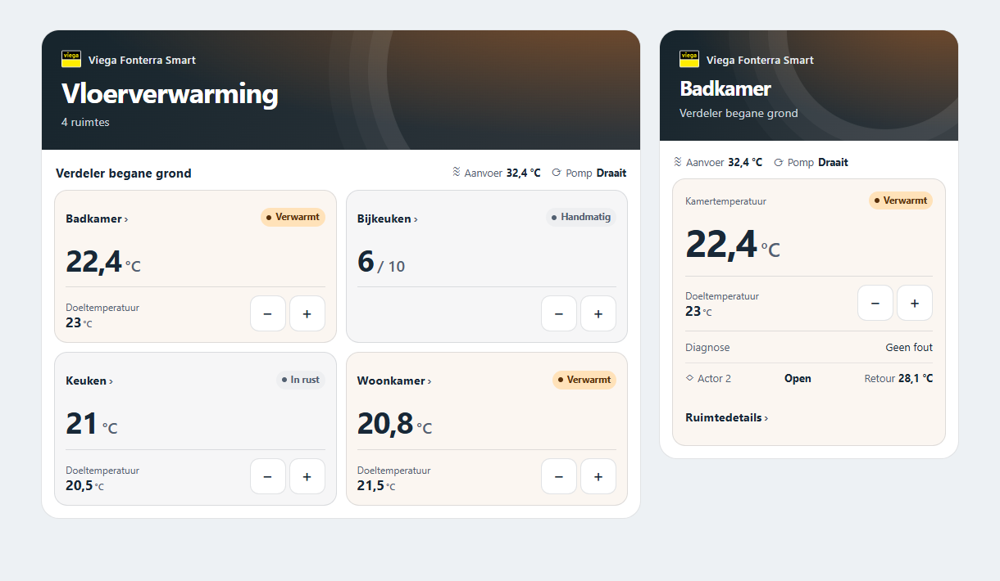

# Viega Fonterra Smart

[Nederlands](https://github.com/roelbroersma/viega-fonterra-smart-control#nederlands) · [For English, see below](https://github.com/roelbroersma/viega-fonterra-smart-control#english) · [Auf Deutsch weiterlesen](https://github.com/roelbroersma/viega-fonterra-smart-control#deutsch) · [Français](https://github.com/roelbroersma/viega-fonterra-smart-control#français) · [Italiano](https://github.com/roelbroersma/viega-fonterra-smart-control#italiano)

## Nederlands

Regel je Viega Fonterra Smart Control-vloerverwarming vanuit Home Assistant. De integratie vindt je verdelers via het netwerk en leest de kamerindeling uit. De dashboardkaart toont temperaturen, klepstanden en diagnose en laat je de ruimtetemperatuur instellen.

**Connect Upgrade is optioneel.** De gewone bediening in Home Assistant werkt via Modbus TCP. Met de upgrade kun je per ruimte de gemeten temperatuur van je eigen sensor naar Fonterra sturen, bijvoorbeeld van een KNX-wandsensor. Zo kan Fonterra die ruimte met jouw sensor regelen. [Meer over Connect Upgrade bij Gigaweb](https://www.gigaweb.nl/fonterra-smart-control-upgrade/)

[](https://youtu.be/9AwHivhxR24)

[Bekijk de film op YouTube](https://youtu.be/9AwHivhxR24)

**Inhoud**

- [Vereisten](https://github.com/roelbroersma/viega-fonterra-smart-control#vereisten)
- [Installeren](https://github.com/roelbroersma/viega-fonterra-smart-control#installeren)
- [Dashboardkaart](https://github.com/roelbroersma/viega-fonterra-smart-control#dashboardkaart)
- [Je eigen temperatuursensor](https://github.com/roelbroersma/viega-fonterra-smart-control#je-eigen-temperatuursensor)
- [Kamers en verbinding](https://github.com/roelbroersma/viega-fonterra-smart-control#kamers-en-verbinding)
- [Hulp en ontwikkeling](https://github.com/roelbroersma/viega-fonterra-smart-control#hulp-en-ontwikkeling)

### Vereisten

Home Assistant 2026.11.0 of nieuwer. Schakel Modbus TCP in Fonterra in en zorg dat Home Assistant de verdeler op poort 502 kan bereiken.

### Installeren

1. Zoek naar **Viega Fonterra Smart** onder **Instellingen > Marketplace**. Zie je hem nog niet? [Open de integratie via deze link](https://my.home-assistant.io/redirect/marketplace_repository/?owner=roelbroersma&repository=viega-fonterra-smart-control&category=integration). Je kunt de GitHub-repository ook invoeren via **Voeg toe via link**.
2. Open **Viega Fonterra Smart** in de Marketplace en kies **Installeren**. Herstart Home Assistant als daarom wordt gevraagd.
3. Open **Instellingen > Apparaten & diensten** en bevestig de gevonden verdeler. Je kunt **Viega Fonterra Smart** ook toevoegen met het IP-adres of de hostnaam. Elke verdeler krijgt een eigen vermelding.

Voor een handmatige installatie pak je de ZIP van de [GitHub-release](https://github.com/roelbroersma/viega-fonterra-smart-control/releases/latest) uit. Kopieer `custom_components/viega_fonterra_modbus` naar de gelijknamige map in je Home Assistant-configuratie en herstart.

### Dashboardkaart

Vernieuw je browser na de herstart. Kies **Dashboard bewerken > Kaart toevoegen > Viega Fonterra Smart**. Gebruik het overzicht voor alle ruimtes of kies één kamer. Stel de doeltemperatuur bij of wijzig de vermogensstand voor een losse actor die deze bediening ondersteunt. Per actor zie je de klepstand en retourtemperatuur. Een kamerfout verschijnt onder **Diagnose**, op basis van de foutcode van Fonterra.



Gebruik deze YAML voor een ruimtekaart.

```yaml
type: custom:viega-fonterra-card
entity: climate.voorbeeld_badkamer
```

Vervang de entiteit door je eigen klimaatentiteit. Laat `entity` weg voor het overzicht.

#### Geschiedenis per ruimte

Voeg onder de ruimtekaart een **Geschiedenisgrafiek** toe en selecteer de Fonterra-klimaatentiteit van de kamer. Home Assistant toont de gemeten en ingestelde temperatuur en markeert de periodes waarin de kamer verwarmt. De grafiek gebruikt de geschiedenis die Home Assistant heeft opgeslagen.

```yaml
type: history-graph
title: Badkamer
hours_to_show: 24
entities:
  - climate.voorbeeld_badkamer
```

Kopieer de kaart voor elke ruimte en vervang de titel en de klimaatentiteit.

### Je eigen temperatuursensor

1. Zet de ruimte in Fonterra op **Extern gemeten**. Dit kan met de [Connected Upgrade](https://www.gigaweb.nl/fonterra-smart-control-upgrade/).
2. Vink **Connect Upgrade geïnstalleerd** aan onder **Configureren** in Home Assistant en sla op.
3. Open de verdeler via **Instellingen > Apparaten & diensten > Viega Fonterra Smart**. De invoer **Badkamer externe temperatuurinvoer** is direct beschikbaar. Elke ontdekte ruimte krijgt een eigen invoer.

Test de invoer met een actuele meting. Gebruik daarna de actie **Getal instellen** in een automatisering. Dit voorbeeld stuurt elke minuut de waarde van een temperatuursensor in °C, zolang die in de afgelopen tien minuten een meting heeft gemeld. Vervang de twee entiteits-ID's door die van jouw installatie.

```yaml
alias: Badkamer temperatuur doorgeven
triggers:
  - trigger: time_pattern
    minutes: "/1"
conditions:
  - condition: template
    value_template: >
      {{ is_number(states('sensor.badkamer_temperatuur'))
          and as_timestamp(now()) - as_timestamp(states.sensor.badkamer_temperatuur.last_reported, 0) < 600 }}
actions:
  - action: number.set_value
    target:
      entity_id: number.fonterra_badkamer_externe_temperatuurinvoer
    data:
      value: "{{ states('sensor.badkamer_temperatuur') | float }}"
```

Laat je sensor ook bij een gelijkblijvende temperatuur metingen melden. Voor KNX kun je daarvoor bijvoorbeeld de sensor laten antwoorden op leesverzoeken en `always_callback` en `sync_state` instellen. De invoer stuurt per aanroep één meting. De gewenste temperatuur stel je in via de thermostaatkaart.

Had je al een sensor gekoppeld via de integratie? Die blijft werken tot de eerste geslaagde meting via de nieuwe invoer. Vanaf dat moment levert je automatisering de metingen aan. Schakel je de invoer uit, dan stopt het doorgeven voor die ruimte.

### Kamers en verbinding

Voeg ruimtes toe, hernoem of verwijder ze in de Fonterra-webinterface onder **Groepen en actoren**. Home Assistant leest de ruimtes met een gekoppelde actor en hun namen bij het laden uit. Meerdere actoren kunnen bij dezelfde ruimte horen.

Kies na een wijziging **Herladen** in het menu van de integratievermelding. Je kunt ook onder **Ontwikkelaarstools > Acties** de actie **Ruimten opnieuw ontdekken** uitvoeren voor de verdeler. Nieuwe ruimtes komen erbij en verwijderde ruimtes vallen uit de actieve indeling. Bij nul gevonden ruimtes bewaart de integratie de laatst bekende indeling.

Verwarmen, koelen en stand-by gelden voor de hele basisunit.

Home Assistant controleert het WLAN-serienummer voordat het bij een bekende verdeler een nieuw adres overneemt. Je kunt het adres ook handmatig aanpassen bij **Configureren**.

### Hulp en ontwikkeling

De kaart en integratie volgen de taal van Home Assistant. Nederlands, Engels, Duits, Frans en Italiaans zijn beschikbaar. Meld problemen via [GitHub Issues](https://github.com/roelbroersma/viega-fonterra-smart-control/issues) met je Home Assistant-versie en de relevante foutmelding.

[Tests, bouwen en release-informatie](RELEASE.md) · [Bronnen en licenties](THIRD_PARTY_NOTICES.md)

## English

Control your Viega Fonterra Smart Control underfloor heating from Home Assistant. The integration discovers your controllers on the network and reads the room layout. The dashboard card shows temperatures, valve positions and diagnostics and lets you adjust the room setpoint.

**Connect Upgrade is optional.** Standard Home Assistant controls work over Modbus TCP. With the upgrade, you can send temperature readings from your own sensor to Fonterra for each room, such as from a KNX wall sensor. Fonterra uses those readings to control the room. [Learn about Connect Upgrade at Gigaweb](https://www.gigaweb.nl/fonterra-smart-control-upgrade/)

[](https://youtu.be/9AwHivhxR24)

[Watch the film on YouTube](https://youtu.be/9AwHivhxR24)

**Contents**

- [Requirements](https://github.com/roelbroersma/viega-fonterra-smart-control#requirements)
- [Installation](https://github.com/roelbroersma/viega-fonterra-smart-control#installation)
- [Dashboard card](https://github.com/roelbroersma/viega-fonterra-smart-control#dashboard-card)
- [Using your own temperature sensor](https://github.com/roelbroersma/viega-fonterra-smart-control#using-your-own-temperature-sensor)
- [Rooms and connectivity](https://github.com/roelbroersma/viega-fonterra-smart-control#rooms-and-connectivity)
- [Help and development](https://github.com/roelbroersma/viega-fonterra-smart-control#help-and-development)

### Requirements

Home Assistant 2026.11.0 or later. Enable Modbus TCP in Fonterra and make sure Home Assistant can reach the controller on port 502.

### Installation

1. Search for **Viega Fonterra Smart** under **Settings > Marketplace**. If it does not appear, [open the integration from this link](https://my.home-assistant.io/redirect/marketplace_repository/?owner=roelbroersma&repository=viega-fonterra-smart-control&category=integration). You can also enter the GitHub repository under **Settings > Marketplace > Add from link**.
2. Open **Viega Fonterra Smart** in the Marketplace and choose **Install**. Restart Home Assistant if prompted.
3. Go to **Settings > Devices & services** and confirm the discovered controller. You can also add **Viega Fonterra Smart** using the IP address or hostname. Each controller has its own entry.

For manual installation, extract the ZIP from the [GitHub release](https://github.com/roelbroersma/viega-fonterra-smart-control/releases/latest). Copy `custom_components/viega_fonterra_modbus` to the matching folder in your Home Assistant configuration and restart.

### Dashboard card

Refresh your browser after restarting. Go to **Edit dashboard > Add card > Viega Fonterra Smart**. Use the overview for all rooms or select a single room. Adjust the setpoint or change the power level for a standalone actuator that supports it. The card shows the valve position and return temperature for each actuator. Room faults appear under **Diagnostics**, based on the code reported by Fonterra. [View the dashboard screenshot](docs/dashboard.png)

Use this YAML to add a room card.

```yaml
type: custom:viega-fonterra-card
entity: climate.example_bathroom
```

Replace the example with your climate entity. Omit `entity` for the overview.

#### Room history

Add a **History graph** below the room card and select the Fonterra climate entity for that room. Home Assistant shows the measured temperature, the setpoint and the periods when the room was heating. The graph uses the history recorded by Home Assistant.

```yaml
type: history-graph
title: Bathroom
hours_to_show: 24
entities:
  - climate.example_bathroom
```

Duplicate the card for each room and change its title and climate entity.

### Using your own temperature sensor

1. Set the room to **External measured** in Fonterra. This option is available with the [Connected Upgrade](https://www.gigaweb.nl/fonterra-smart-control-upgrade/).
2. Under **Configure** in Home Assistant, tick **Connect Upgrade installed** and save.
3. Open the controller under **Settings > Devices & services > Viega Fonterra Smart**. **Bathroom external temperature input** is ready to use. Each discovered room has its own input.

Test the input with a current reading, then use **Set value** in an automation. This example sends a reading in °C once per minute if the sensor has reported within the last ten minutes. Replace both entity IDs with your own.

```yaml
alias: Send bathroom temperature
triggers:
  - trigger: time_pattern
    minutes: "/1"
conditions:
  - condition: template
    value_template: >
      {{ is_number(states('sensor.bathroom_temperature'))
          and as_timestamp(now()) - as_timestamp(states.sensor.bathroom_temperature.last_reported, 0) < 600 }}
actions:
  - action: number.set_value
    target:
      entity_id: number.fonterra_bathroom_external_temperature_input
    data:
      value: "{{ states('sensor.bathroom_temperature') | float }}"
```

Use a sensor that also reports when its value stays the same. For KNX, for example, configure the sensor to answer read requests and set `always_callback` and `sync_state`. Each action sends one reading. Set the target temperature on the thermostat card.

An existing sensor link keeps working until the first successful measurement through the new input. Your automation supplies subsequent readings. Disabling the input stops sending measurements for that room.

### Rooms and connectivity

Add, rename or remove rooms in Fonterra's web interface under **Groups and actuators**. When the integration loads, Home Assistant reads rooms with a linked actuator and their names. A room can have multiple actuators.

After a change, select **Reload** in the integration entry menu. You can also run **Rediscover rooms** for the controller under **Developer tools > Actions**. Home Assistant adds new rooms and removes deleted rooms from the active layout. If no rooms are found, the integration keeps the last known layout.

Heating, cooling and standby apply to the entire base unit.

Home Assistant verifies the Wi-Fi module serial before adopting a new address for a known controller. You can also change the address manually under **Configure**.

### Help and development

The card and integration follow your Home Assistant language. Dutch, English, German, French and Italian are available. Report problems via [GitHub Issues](https://github.com/roelbroersma/viega-fonterra-smart-control/issues) with your Home Assistant version and the relevant error.

[Tests, build instructions and release information](RELEASE.md) · [Sources and licenses](THIRD_PARTY_NOTICES.md)

## Deutsch

Steuern Sie Ihre Viega Fonterra Smart-Control-Fußbodenheizung in Home Assistant. Die Integration findet Ihre Verteiler im Netzwerk und liest die Raumaufteilung aus. Die Dashboard-Karte zeigt Temperaturen, Ventilstellungen und Diagnose an. Dort können Sie auch die Solltemperatur einstellen.

**Das Connect Upgrade ist optional.** Die normale Bedienung in Home Assistant funktioniert über Modbus TCP. Mit dem Upgrade können Sie für jeden Raum Messwerte eines eigenen Sensors an Fonterra senden, etwa von einem KNX-Wandsensor. Fonterra nutzt die Messwerte zur Raumregelung. [Mehr über das Connect Upgrade bei Gigaweb](https://www.gigaweb.nl/fonterra-smart-control-upgrade/)

[](https://youtu.be/9AwHivhxR24)

[Film auf YouTube ansehen](https://youtu.be/9AwHivhxR24)

**Inhalt**

- [Voraussetzungen](https://github.com/roelbroersma/viega-fonterra-smart-control#voraussetzungen)
- [Installation](https://github.com/roelbroersma/viega-fonterra-smart-control#inbetriebnahme)
- [Dashboard-Karte](https://github.com/roelbroersma/viega-fonterra-smart-control#dashboard-karte)
- [Eigenen Temperatursensor verwenden](https://github.com/roelbroersma/viega-fonterra-smart-control#eigenen-temperatursensor-verwenden)
- [Räume und Verbindung](https://github.com/roelbroersma/viega-fonterra-smart-control#räume-und-verbindung)
- [Hilfe und Entwicklung](https://github.com/roelbroersma/viega-fonterra-smart-control#hilfe-und-entwicklung)

### Voraussetzungen

Home Assistant 2026.11.0 oder neuer. Aktivieren Sie Modbus TCP in Fonterra. Home Assistant muss den Verteiler über Port 502 erreichen können.

### Inbetriebnahme

1. Suchen Sie unter **Einstellungen > Marketplace** nach **Viega Fonterra Smart**. Falls der Eintrag fehlt, [öffnen Sie die Integration über diesen Link](https://my.home-assistant.io/redirect/marketplace_repository/?owner=roelbroersma&repository=viega-fonterra-smart-control&category=integration). Sie können das GitHub-Repository auch unter **Einstellungen > Marketplace > Per Link hinzufügen** eingeben.
2. Öffnen Sie **Viega Fonterra Smart** im Marketplace und wählen Sie **Installieren**. Starten Sie Home Assistant neu, wenn Sie dazu aufgefordert werden.
3. Öffnen Sie **Einstellungen > Geräte & Dienste** und bestätigen Sie den gefundenen Verteiler. Sie können **Viega Fonterra Smart** auch über IP-Adresse oder Hostnamen hinzufügen. Jeder Verteiler erhält einen eigenen Eintrag.

Für die manuelle Installation entpacken Sie die ZIP-Datei aus dem [GitHub-Release](https://github.com/roelbroersma/viega-fonterra-smart-control/releases/latest). Kopieren Sie `custom_components/viega_fonterra_modbus` in den gleichnamigen Ordner Ihrer Home-Assistant-Konfiguration und starten Sie Home Assistant neu.

### Dashboard-Karte

Laden Sie die Browserseite nach dem Neustart neu. Wählen Sie **Dashboard bearbeiten > Karte hinzufügen > Viega Fonterra Smart**. Verwenden Sie die Übersicht für alle Räume oder wählen Sie einen einzelnen Raum. Stellen Sie die Solltemperatur ein oder ändern Sie die Leistungsstufe eines einzelnen Stellantriebs, sofern diese Funktion verfügbar ist. Für jeden Stellantrieb zeigt die Karte die Ventilstellung und Rücklauftemperatur an. Raumfehler erscheinen unter **Diagnose** mit der von Fonterra gemeldeten Störung. [Dashboard ansehen](docs/dashboard.png)

Mit diesem YAML-Beispiel fügen Sie eine Raumkarte hinzu.

```yaml
type: custom:viega-fonterra-card
entity: climate.beispiel_badezimmer
```

Ersetzen Sie das Beispiel durch Ihre Klimaentität. Lassen Sie `entity` für die Übersicht weg.

#### Raumverlauf

Fügen Sie unter der Raumkarte ein **Verlaufsdiagramm** hinzu und wählen Sie die Fonterra-Klimaentität des Raums. Home Assistant zeigt die gemessene Temperatur, die Solltemperatur und die Zeiträume, in denen der Raum beheizt wurde. Das Diagramm verwendet den von Home Assistant aufgezeichneten Verlauf.

```yaml
type: history-graph
title: Badezimmer
hours_to_show: 24
entities:
  - climate.beispiel_badezimmer
```

Kopieren Sie die Karte für jeden Raum und ändern Sie den Titel und die Klimaentität.

### Eigenen Temperatursensor verwenden

1. Stellen Sie die Temperaturquelle des Raums in Fonterra auf **Extern gemessen**. Diese Option ist mit dem [Connected Upgrade](https://www.gigaweb.nl/fonterra-smart-control-upgrade/) verfügbar.
2. Aktivieren Sie in Home Assistant unter **Konfigurieren** die Option **Connect Upgrade installiert** und speichern Sie.
3. Öffnen Sie den Verteiler unter **Einstellungen > Geräte & Dienste > Viega Fonterra Smart**. **Badezimmer externe Temperatureingabe** ist sofort verfügbar. Jeder erkannte Raum erhält eine eigene Eingabe.

Testen Sie die Eingabe mit einem aktuellen Messwert und verwenden Sie anschließend die Aktion **Wert setzen** in einer Automation. Das Beispiel sendet jede Minute den Messwert in °C, sofern der Sensor in den letzten zehn Minuten gemeldet hat. Ersetzen Sie beide Entitäts-IDs durch Ihre eigenen.

```yaml
alias: Badezimmertemperatur übertragen
triggers:
  - trigger: time_pattern
    minutes: "/1"
conditions:
  - condition: template
    value_template: >
      {{ is_number(states('sensor.badezimmertemperatur'))
          and as_timestamp(now()) - as_timestamp(states.sensor.badezimmertemperatur.last_reported, 0) < 600 }}
actions:
  - action: number.set_value
    target:
      entity_id: number.fonterra_badezimmer_externe_temperatureingabe
    data:
      value: "{{ states('sensor.badezimmertemperatur') | float }}"
```

Der Sensor sollte auch bei unveränderter Temperatur Messwerte melden. Bei KNX kann der Sensor beispielsweise auf Leseanfragen antworten. Stellen Sie dafür `always_callback` und `sync_state` ein. Jeder Aufruf überträgt einen Messwert. Die Solltemperatur stellen Sie auf der Thermostatkarte ein.

Eine bestehende Sensorverknüpfung bleibt bis zur ersten erfolgreichen Übertragung über die neue Eingabe aktiv. Danach liefert Ihre Automation die Messwerte. Wenn Sie die Eingabe deaktivieren, endet die Übertragung für diesen Raum.

### Räume und Verbindung

Legen Sie Räume in der Fonterra-Weboberfläche unter **Gruppen und Aktoren** an, benennen Sie sie um oder entfernen Sie sie. Beim Laden liest Home Assistant die Namen und die Räume mit zugeordnetem Stellantrieb aus. Ein Raum kann mehrere Stellantriebe haben.

Wählen Sie nach einer Änderung im Menü des Integrationseintrags **Neu laden**. Alternativ führen Sie unter **Entwicklerwerkzeuge > Aktionen** für den Verteiler **Räume erneut erkennen** aus. Neue Räume werden hinzugefügt und entfernte Räume aus der aktiven Raumaufteilung genommen. Wenn keine Räume gefunden werden, bleibt die zuletzt bekannte Raumaufteilung erhalten.

Heizen, Kühlen und Stand-by gelten für die gesamte Basiseinheit.

Home Assistant prüft die Seriennummer des WLAN-Moduls, bevor es eine neue Adresse für einen bekannten Verteiler übernimmt. Sie können die Adresse auch unter **Konfigurieren** manuell ändern.

### Hilfe und Entwicklung

Karte und Integration folgen der Spracheinstellung von Home Assistant. Niederländisch, Englisch, Deutsch, Französisch und Italienisch sind verfügbar. Melden Sie Probleme über [GitHub Issues](https://github.com/roelbroersma/viega-fonterra-smart-control/issues) und geben Sie Ihre Home-Assistant-Version und die relevante Fehlermeldung an.

[Tests, Build-Anleitung und Release-Informationen](RELEASE.md) · [Quellen und Lizenzen](THIRD_PARTY_NOTICES.md)

## Français

Pilotez votre plancher chauffant Viega Fonterra Smart Control depuis Home Assistant. L’intégration trouve vos collecteurs sur le réseau et lit la configuration des pièces. La carte affiche les températures, la position des vannes et les diagnostics. Vous pouvez y régler la température de consigne.

**Connect Upgrade est facultatif.** Le pilotage standard dans Home Assistant fonctionne via Modbus TCP. Avec cette extension, vous pouvez transmettre à Fonterra la température mesurée dans chaque pièce par votre propre capteur, par exemple un capteur mural KNX. Fonterra utilise ces mesures pour régler le chauffage de la pièce. [Découvrir Connect Upgrade chez Gigaweb](https://www.gigaweb.nl/fonterra-smart-control-upgrade/)

[](https://youtu.be/9AwHivhxR24)

[Voir le film sur YouTube](https://youtu.be/9AwHivhxR24)

**Sommaire**

- [Configuration requise](https://github.com/roelbroersma/viega-fonterra-smart-control#configuration-requise)
- [Installer Viega Fonterra](https://github.com/roelbroersma/viega-fonterra-smart-control#installer-viega-fonterra)
- [Carte du tableau de bord](https://github.com/roelbroersma/viega-fonterra-smart-control#carte-du-tableau-de-bord)
- [Utiliser son propre capteur](https://github.com/roelbroersma/viega-fonterra-smart-control#utiliser-son-propre-capteur)
- [Pièces et connexion](https://github.com/roelbroersma/viega-fonterra-smart-control#pièces-et-connexion)
- [Aide et développement](https://github.com/roelbroersma/viega-fonterra-smart-control#aide-et-développement)

### Configuration requise

Home Assistant 2026.11.0 ou version ultérieure. Activez Modbus TCP dans Fonterra. Home Assistant doit pouvoir joindre le collecteur sur le port 502.

### Installer Viega Fonterra

1. Cherchez **Viega Fonterra Smart** dans **Paramètres > Marketplace** ou [ouvrez l’intégration dans Marketplace](https://my.home-assistant.io/redirect/marketplace_repository/?owner=roelbroersma&repository=viega-fonterra-smart-control&category=integration). Vous pouvez aussi ajouter le lien du dépôt GitHub dans Marketplace.
2. Sélectionnez **Installer**, puis redémarrez Home Assistant si nécessaire.
3. Ouvrez **Paramètres > Appareils et services** et confirmez le collecteur détecté. Vous pouvez aussi ajouter **Viega Fonterra Smart** avec son adresse IP ou son nom d’hôte. Chaque collecteur a sa propre entrée.

Pour une installation manuelle, extrayez l’archive ZIP de la [version GitHub](https://github.com/roelbroersma/viega-fonterra-smart-control/releases/latest). Copiez `custom_components/viega_fonterra_modbus` dans le dossier correspondant de votre configuration Home Assistant, puis redémarrez.

### Carte du tableau de bord

Actualisez le navigateur après le redémarrage. Sélectionnez **Modifier le tableau de bord > Ajouter une carte > Viega Fonterra Smart**. Affichez toutes les pièces ou sélectionnez-en une. Ajustez la consigne ou la puissance d’un actionneur indépendant qui accepte ce réglage. La carte affiche la position de la vanne et la température de retour de chaque actionneur. Les défauts signalés par Fonterra apparaissent dans **Diagnostic**. [Voir la carte](docs/dashboard.png)

```yaml
type: custom:viega-fonterra-card
entity: climate.exemple_salle_de_bain
```

Remplacez l’entité par celle de votre thermostat. Omettez `entity` pour afficher toutes les pièces.

#### Historique par pièce

Ajoutez un **Graphique d’historique** sous la carte de la pièce et sélectionnez son entité de thermostat Fonterra. Le graphique utilise l’historique de Home Assistant pour afficher la température mesurée, la consigne et les périodes de chauffe.

```yaml
type: history-graph
title: Salle de bain
hours_to_show: 24
entities:
  - climate.exemple_salle_de_bain
```

### Utiliser son propre capteur

1. Dans Fonterra, réglez la source de température de la pièce sur la mesure externe (**Extern gemeten** dans l’interface néerlandaise).
2. Dans Home Assistant, ouvrez **Configurer**, cochez **Connect Upgrade installé** et enregistrez.
3. Ouvrez le collecteur dans **Paramètres > Appareils et services > Viega Fonterra Smart**. **Salle de bain entrée de température externe** est directement disponible. Chaque pièce détectée dispose de sa propre entrée.

Testez l’entrée avec une mesure actuelle, puis utilisez l’action `number.set_value` dans une automatisation. L’exemple transmet chaque minute une mesure en °C si le capteur a envoyé une valeur dans les dix dernières minutes. Remplacez les deux identifiants d’entité.

```yaml
alias: Transmettre la température de la salle de bain
triggers:
  - trigger: time_pattern
    minutes: "/1"
conditions:
  - condition: template
    value_template: >
      {{ is_number(states('sensor.temperature_salle_de_bain'))
          and as_timestamp(now()) - as_timestamp(states.sensor.temperature_salle_de_bain.last_reported, 0) < 600 }}
actions:
  - action: number.set_value
    target:
      entity_id: number.fonterra_salle_de_bain_entree_de_temperature_externe
    data:
      value: "{{ states('sensor.temperature_salle_de_bain') | float }}"
```

Choisissez un capteur qui envoie des mesures même quand la température reste stable. Pour KNX, vous pouvez configurer `always_callback` et `sync_state` sur un capteur qui répond aux demandes de lecture. Chaque appel transmet une mesure. Réglez la température de consigne sur la carte du thermostat.

Un capteur déjà associé continue de fonctionner jusqu’à la première transmission réussie via la nouvelle entrée. Votre automatisation fournit ensuite les mesures. La désactivation de l’entrée arrête l’envoi pour cette pièce.

### Pièces et connexion

Ajoutez, renommez ou retirez les pièces dans l’interface Fonterra sous **Groupes et actionneurs** (**Groepen en actoren** en néerlandais). Au chargement, Home Assistant lit les noms des pièces auxquelles un actionneur est associé. Une pièce peut avoir plusieurs actionneurs.

Après une modification, choisissez **Recharger** dans le menu de l’intégration. Vous pouvez aussi lancer **Relire les pièces** pour le collecteur dans **Outils de développement > Actions**. Les nouvelles pièces s’affichent et les pièces retirées quittent la configuration active. Si aucune pièce n’est détectée, la dernière configuration connue est conservée.

Le chauffage, le refroidissement et la veille s’appliquent à l’ensemble de l’unité de base. Home Assistant vérifie le numéro de série du module Wi-Fi avant de prendre en compte une nouvelle adresse pour un collecteur connu. Vous pouvez aussi modifier l’adresse dans **Configurer**.

### Aide et développement

La carte et l’intégration suivent la langue de Home Assistant. Le néerlandais, l’anglais, l’allemand, le français et l’italien sont disponibles. Pour signaler un problème, indiquez votre version de Home Assistant et le message d’erreur. [Signaler un problème](https://github.com/roelbroersma/viega-fonterra-smart-control/issues)

[Tests et publication](RELEASE.md) · [Sources et licences](THIRD_PARTY_NOTICES.md)

## Italiano

Controlla il riscaldamento a pavimento Viega Fonterra Smart Control da Home Assistant. L’integrazione rileva i collettori in rete e legge la configurazione delle stanze. La scheda mostra temperature, posizione delle valvole e diagnostica. Puoi anche impostare la temperatura desiderata.

**Connect Upgrade è facoltativo.** I comandi standard di Home Assistant funzionano tramite Modbus TCP. Con l’upgrade puoi inviare a Fonterra la temperatura di ogni stanza misurata dal tuo sensore, per esempio un sensore a parete KNX. Fonterra usa queste misurazioni per regolare la temperatura della stanza. [Scopri Connect Upgrade su Gigaweb](https://www.gigaweb.nl/fonterra-smart-control-upgrade/)

[](https://youtu.be/9AwHivhxR24)

[Guarda il video su YouTube](https://youtu.be/9AwHivhxR24)

**Indice**

- [Requisiti](https://github.com/roelbroersma/viega-fonterra-smart-control#requisiti)
- [Installare Viega Fonterra](https://github.com/roelbroersma/viega-fonterra-smart-control#installare-viega-fonterra)
- [Scheda del pannello](https://github.com/roelbroersma/viega-fonterra-smart-control#scheda-del-pannello)
- [Usare il proprio sensore](https://github.com/roelbroersma/viega-fonterra-smart-control#usare-il-proprio-sensore)
- [Stanze e connessione](https://github.com/roelbroersma/viega-fonterra-smart-control#stanze-e-connessione)
- [Assistenza e sviluppo](https://github.com/roelbroersma/viega-fonterra-smart-control#assistenza-e-sviluppo)

### Requisiti

Home Assistant 2026.11.0 o successivo. Abilita Modbus TCP in Fonterra. Home Assistant deve poter raggiungere il collettore sulla porta 502.

### Installare Viega Fonterra

1. Cerca **Viega Fonterra Smart** in **Impostazioni > Marketplace** oppure [apri l’integrazione nel Marketplace](https://my.home-assistant.io/redirect/marketplace_repository/?owner=roelbroersma&repository=viega-fonterra-smart-control&category=integration). Puoi anche aggiungere il link al repository GitHub nel Marketplace.
2. Seleziona **Installa** e riavvia Home Assistant se richiesto.
3. Apri **Impostazioni > Dispositivi e servizi** e conferma il collettore rilevato. Puoi anche aggiungere **Viega Fonterra Smart** tramite indirizzo IP o nome host. Ogni collettore ha la propria voce.

Per l’installazione manuale, estrai lo ZIP dalla [versione su GitHub](https://github.com/roelbroersma/viega-fonterra-smart-control/releases/latest). Copia `custom_components/viega_fonterra_modbus` nella cartella corrispondente della configurazione di Home Assistant e riavvia.

### Scheda del pannello

Aggiorna il browser dopo il riavvio. Seleziona **Modifica pannello > Aggiungi scheda > Viega Fonterra Smart**. Mostra tutte le stanze o scegline una. Regola la temperatura desiderata o il livello di potenza per un attuatore indipendente che supporta questa funzione. Per ogni attuatore vedi la posizione della valvola e la temperatura di ritorno. I guasti segnalati da Fonterra appaiono in **Diagnostica**. [Vedi la scheda](docs/dashboard.png)

```yaml
type: custom:viega-fonterra-card
entity: climate.esempio_bagno
```

Sostituisci l’entità con quella del termostato. Ometti `entity` per visualizzare tutte le stanze.

#### Cronologia per stanza

Aggiungi un **Grafico cronologico** sotto la scheda della stanza e seleziona l’entità del termostato Fonterra. Il grafico usa la cronologia di Home Assistant per mostrare la temperatura misurata, quella impostata e i periodi di riscaldamento.

```yaml
type: history-graph
title: Bagno
hours_to_show: 24
entities:
  - climate.esempio_bagno
```

### Usare il proprio sensore

1. In Fonterra, seleziona la misurazione esterna come sorgente di temperatura della stanza (**Extern gemeten** nell’interfaccia olandese).
2. In Home Assistant, apri **Configura**, seleziona **Connect Upgrade installato** e salva.
3. Apri il collettore da **Impostazioni > Dispositivi e servizi > Viega Fonterra Smart**. **Bagno ingresso temperatura esterna** è subito disponibile. Ogni stanza rilevata ha il proprio ingresso.

Prova l’ingresso con una misurazione attuale e poi usa l’azione `number.set_value` in un’automazione. L’esempio invia ogni minuto la temperatura in °C se il sensore ha ricevuto un valore negli ultimi dieci minuti. Sostituisci entrambi gli ID delle entità con i tuoi.

```yaml
alias: Invia la temperatura del bagno
triggers:
  - trigger: time_pattern
    minutes: "/1"
conditions:
  - condition: template
    value_template: >
      {{ is_number(states('sensor.temperatura_bagno'))
          and as_timestamp(now()) - as_timestamp(states.sensor.temperatura_bagno.last_reported, 0) < 600 }}
actions:
  - action: number.set_value
    target:
      entity_id: number.fonterra_bagno_ingresso_temperatura_esterna
    data:
      value: "{{ states('sensor.temperatura_bagno') | float }}"
```

Il sensore deve inviare misurazioni anche quando la temperatura rimane invariata. Per KNX puoi impostare `always_callback` e `sync_state` se il sensore risponde alle richieste di lettura. Ogni chiamata invia una misurazione. Imposta la temperatura desiderata sulla scheda del termostato.

Un sensore già collegato continua a funzionare fino al primo invio riuscito tramite il nuovo ingresso. Da quel momento l’automazione fornisce le misurazioni. Disabilitando l’ingresso, l’invio per la stanza si interrompe.

### Stanze e connessione

Aggiungi, rinomina o rimuovi le stanze nell’interfaccia web di Fonterra, sotto **Gruppi e attuatori** (**Groepen en actoren** in olandese). Quando l’integrazione si carica, Home Assistant legge i nomi delle stanze con almeno un attuatore associato. Ogni stanza può avere più attuatori.

Dopo una modifica, scegli **Ricarica** nel menu dell’integrazione. Puoi anche eseguire **Rileva di nuovo le stanze** per il collettore in **Strumenti per sviluppatori > Azioni**. Le nuove stanze vengono aggiunte e quelle rimosse escono dalla configurazione attiva. Se non viene rilevata alcuna stanza, l’integrazione conserva l’ultima configurazione nota.

Riscaldamento, raffrescamento e standby si applicano all’intera unità di base. Home Assistant verifica il numero di serie del modulo Wi-Fi prima di utilizzare un nuovo indirizzo per un collettore noto. Puoi anche modificare l’indirizzo da **Configura**.

### Assistenza e sviluppo

La scheda e l’integrazione seguono la lingua di Home Assistant. Sono disponibili olandese, inglese, tedesco, francese e italiano. Per segnalare un problema, indica la versione di Home Assistant e il messaggio di errore. [Segnala un problema](https://github.com/roelbroersma/viega-fonterra-smart-control/issues)

[Test e pubblicazione](RELEASE.md) · [Fonti e licenze](THIRD_PARTY_NOTICES.md)
